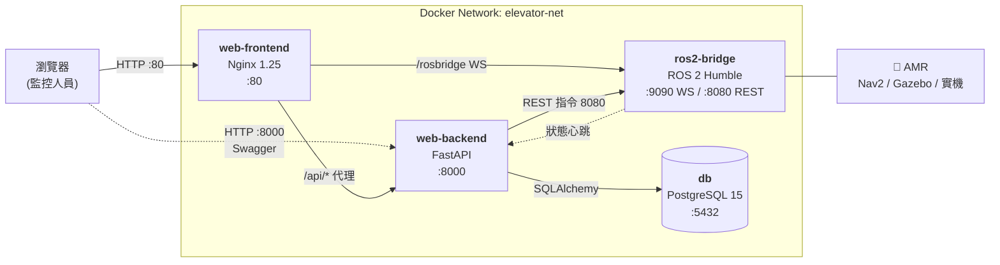
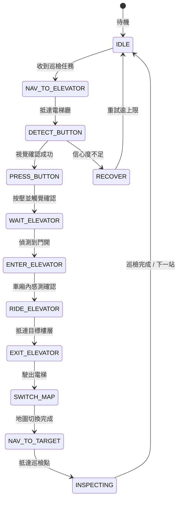
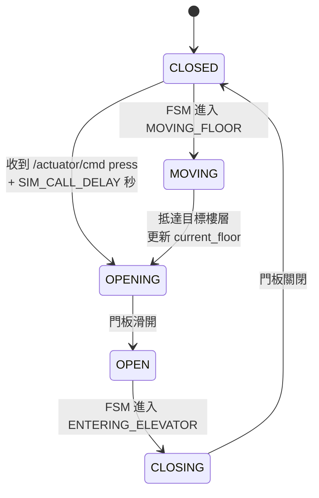
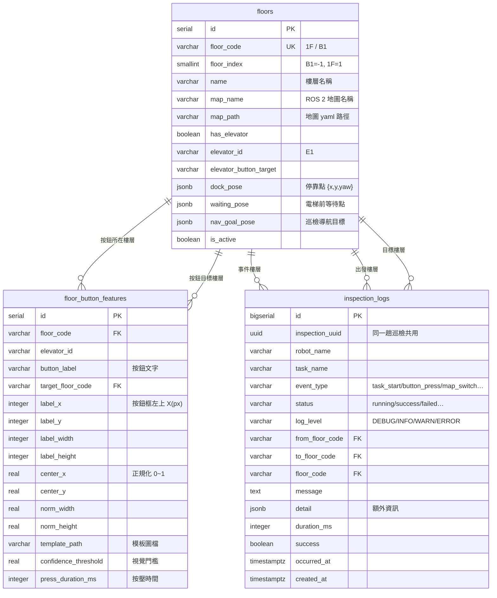

# HW5 — ROS 2 跨樓層巡檢機器人監控後台系統

> 現代軟體工程 · HW5 · 以 Docker 微服務架構打造 ROS 2 AMR 的跨樓層巡檢與電梯搭乘監控系統

🔙 [回首頁](../)

## 一、作業概述

本作業實作一套 **ROS 2 自主移動機器人（AMR）** 的跨樓層巡檢監控後台。核心挑戰在於讓機器人能「自主搭電梯」：從 1F 巡檢到 5F，過程中必須辨識電梯按鈕、按壓確認、進出車廂、切換對應樓層地圖，並把每個環節即時傳回 Web 儀表板與資料庫。

| 項目 | 內容 |
|---|---|
| 作業主題 | ROS 2 微服務架構設計與跨樓層狀態機實作 |
| 核心技術 | ROS 2 Humble / FastAPI / PostgreSQL / Nginx / Docker Compose |
| 專案規模 | 4 個容器服務、約 30 個原始碼檔案、3 張資料表 |

---

## 二、學習目標

- 理解 **微服務架構**如何拆分職責，以及服務間的鬆耦合通訊設計
- 掌握 **FSM（Finite State Machine）** 建模複雜跨設備行為（跨樓層移動）
- 實作 **Web 與 ROS 2 的橋接方案**（rosbridge WebSocket + REST 雙通道）
- 熟悉 **Docker 多容器網路编排**與服務依賴管理
- 建立 **可追溯的稽核日誌**設計（事件驅動的資料紀錄）

---

## 三、系統架構

### 3.1 微服務拓撲



### 3.2 服務職責

| 服務 | 映像 | 對外埠 | 職責 |
|---|---|---|---|
| **web-frontend** | `nginx:1.25-alpine` | `80` | 託管監控儀表板；反向代理 `/api/*` → backend、`/rosbridge` → ros2-bridge |
| **web-backend** | `python:3.11-slim` | `8000` | 業務邏輯、樓層資訊／地圖路徑管理、巡檢紀錄 API、指令轉送 |
| **ros2-bridge** | `ros:humble-ros-base` | `9090` / `8080` | `rosbridge_server`、跨樓層巡檢狀態機（FSM）、按鈕視覺辨識、地圖動態切換 |
| **db** | `postgres:15` | `5432` | 持久化樓層資訊、按鈕座標特徵、巡檢事件日誌（Docker Volume） |

### 3.3 架構設計考量

**為什麼拆成微服務？**
未來移植到實體機器人（Jetson / 樹莓派）時，只需部署 `ros2-bridge`，後台監控留在機房，兩者透過網路鬆耦合通訊。

**Web 與 ROS 之間的雙通道設計**

| 通道 | 埠 | 用途 |
|---|---|---|
| WebSocket (rosbridge) | 9090 | 機器人狀態、影像串流等**即時資料** |
| REST | 8080 | web-backend 下達**控制指令** |

兩條通道皆經 Nginx 代理，前端只對同一網域發送請求。

**狀態資料的即時性 vs. 持久化**

- 即時狀態（FSM 停在哪）→ 記憶體快取（重啟後由輪詢重建）
- 歷史巡檢紀錄 → PostgreSQL（永久保存、支援查詢統計）

---

## 四、檔案結構

```text
ros2-elevator-monitor/
├── docker-compose.yml              # 微服務整合啟動檔
├── .env                            # 環境變數（密碼、埠號、ROS_DOMAIN_ID）
├── README.md                       # 專案詳細說明文件
│
├── frontend/                       # ① 前端監控介面
│   ├── Dockerfile
│   ├── nginx.conf                  # 反向代理設定
│   ├── proxy_common.conf           # 共用代理參數
│   └── src/
│       ├── index.html              # 儀表板版面（狀態／影像／日誌三欄）
│       ├── css/style.css
│       └── js/app.js               # 輪詢 + WebSocket 影像串接
│
├── backend/                        # ② Web API 後端
│   ├── Dockerfile
│   ├── requirements.txt
│   └── app/
│       ├── main.py                 # FastAPI 進入點、lifespan、CORS、Swagger
│       ├── config.py               # 環境變數集中管理
│       ├── database.py             # SQLAlchemy Engine / Session / 連線等待
│       ├── models.py               # ORM 資料模型
│       ├── schemas.py              # Pydantic DTO
│       ├── routers/
│       │   ├── floors.py           # 樓層 CRUD、按鈕特徵、路徑規劃
│       │   ├── inspections.py      # 巡檢日誌寫入／查詢／統計
│       │   └── system.py           # 健康檢查、即時狀態、指令轉送
│       └── services/
│           ├── ros_bridge.py       # 呼叫 ros2-bridge 的 HTTP Client
│           ├── robot_state.py      # 機器人狀態記憶體快取（執行緒安全）
│           └── floor_service.py    # 樓層資料存取 helpers
│
├── ros2_ws/                        # ③ ROS 2 Bridge 與核心控制節點
│   ├── Dockerfile                  # 基於 ros:humble-ros-base
│   ├── entrypoint.sh               # 容器啟動腳本（多程序管理）
│   └── src/elevator_inspection/    # ROS 2 Python Package
│       ├── package.xml
│       ├── setup.py
│       ├── setup.cfg
│       └── elevator_inspection/
│           ├── fsm_node.py             # 跨樓層搭電梯狀態機
│           ├── button_recognizer.py    # 按鈕影像雙重確認邏輯
│           └── bridge_rest_node.py     # REST 控制端點（8080）
│
└── init-db/                        # ④ 資料庫初始化
    └── 01-init.sql                 # 建表 Schema、索引、檢視、種子資料
```

---

## 五、核心業務邏輯

### 5.1 跨樓層巡檢狀態機（FSM）

機器人從 `IDLE` 開始，收到巡檢任務後依序走過下列狀態：



**每個狀態轉移都會產生一筆巡檢日誌**，寫入 `inspection_logs` 表，包含事件類型、樓層、耗時（ms）、是否成功與 JSONB 格式的額外資訊。

### 5.2 按鈕視覺／觸覺雙重確認

這是避免「按錯樓層」的核心機制，分兩個階段：

**階段一：視覺確認（Vision）**
1. 從 `floor_button_features` 取出目標按鈕的座標與模板路徑
2. 對相機影像做 **Template Matching**（OpenCV）或 **YOLO 物件偵測**
3. 相似度需高於 `confidence_threshold`（預設 0.75）才判定成功
4. 失敗則回到 `RECOVER` 重新定位

**階段二：觸覺確認（Tactile）**
1. 按壓機械臂／推桿 `press_duration_ms` 毫秒
2. 由力感測器或行程開關回報是否確實觸發按鈕
3. **視覺與觸覺都通過**才進入 `WAIT_ELEVATOR`

> **雙重確認的意義**：視覺可能因反光、陰影誤判「按到了 5F 按鈕」，但觸覺能確認是否真的壓下開關。兩者不一致時系統會中止並記錄警告日誌。

### 5.3 地圖動態切換（Map Switching）

不同樓層有不同地圖，抵達新樓層後需：
1. 更新 `nav2_map_server` 的地圖檔
2. 清除 Nav2 的 `costmap` 與定位狀態
3. 重新載入地圖並恢復 AMCL 粒子分布
4. 以該樓層的 `dock_pose` 作為定位起點

對應資料存於 `floors` 表的 `map_name` / `map_path` / `dock_pose`（JSONB）欄位。

### 5.4 狀態傳遞機制

```
fsm_node
   │  發佈 JSON 至 /robot_status (std_msgs/String, 5Hz)
   ▼
bridge_rest_node ──► GET /status ──► web-backend 記憶體快取
   │                                        │
   │ 發佈 JSON 至 /inspection/command       │ 前端每 2 秒輪詢
   │        ▲                               ▼
   └── web-backend POST /api/v1/system/command   儀表板顯示
```

web-backend 提供兩種取得狀態的方式，優先使用延遲較低者：

| 方式 | 說明 |
|---|---|
| **主動心跳** | `bridge_rest_node` POST 到 `/api/v1/system/heartbeat`（延遲最低） |
| **背景輪詢** | web-backend 每 5 秒 GET bridge 的 `/status`（備援） |

若最後更新時間超過 `heartbeat_stale_seconds`（預設 30 秒），儀表板會標示為「離線」。

### 5.5 API 請求流向

| 場景 | 請求鏈 |
|---|---|
| 前端載入頁面 | Nginx → `/api/v1/floors` → backend → PostgreSQL |
| 顯示即時狀態 | Nginx → `/api/v1/system/status` → backend 記憶體快取 |
| 下達巡檢指令 | 前端 → `/api/v1/system/command` → backend → bridge REST(8080) → `/inspection/command` → `fsm_node` |
| 機器人回報事件 | `fsm_node` → `/inspection/event_log` → backend → 寫入 `inspection_logs` |
| 影像串流 | 瀏覽器 WebSocket → Nginx `/rosbridge` → rosbridge_server(9090) |

---

### 5.7 硬體抽象層與車載邊緣端（WP 0）

目標：讓 `fsm_node.py` 的**核心狀態機邏輯完全不需要修改**，
就能在模擬環境與實體硬體之間切換。

#### 硬體架構

| 元件 | 規格 | 對應介面 |
|---|---|---|
| 底盤 | IKEA 推車改裝**麥克納姆輪**，平面全向移動 | `MecanumBaseInterface` |
| 視覺 | USB 羅技視訊鏡頭（`/dev/video0`），Eye-in-Hand 掛於推桿旁 | `CameraInterface` |
| 按壓／觸覺 | 線性推桿 + 彈簧微動開關，由 MCU（`/dev/ttyUSB0`）控制 | `ActuatorInterface` |
| 車載電腦 | 樹莓派（ARM64）或迷你電腦（AMD64） | `docker-compose.edge.yml` |

#### 為什麼需要麥克納姆輪

傳統差速底盤要對準按鈕必須「轉向 → 前進 → 再轉向」，
在狹窄的電梯廳裡容易撞到門框。
麥克納姆輪支援**原地全向平移**，只要一句
`linear.y = offset_x_px × PIXEL_TO_METER` 就能微調對準，無需轉身。

#### 四種硬體模式

| 模式 | 相機 | 推桿 | 底盤 | 適用情境 |
|---|---|---|---|---|
| `mock`（預設） | 模擬 | 模擬 | 模擬 | 開發、CI、Demo |
| `hybrid` | **真實**（OpenCV） | 模擬 | 模擬 | 辦公室先驗證視覺管線 |
| `gazebo` | Gazebo / 偽感測器 | 模擬節點 | `/cmd_vel` | **Digital Twin 仿真** |
| `real` | 真實 | **真實**（Serial） | **真實**（`/cmd_vel`） | 實體硬體整合 |

#### 降級策略

若選了真實模式但硬體不可用（裝置不存在、OpenCV 未安裝、pyserial 缺失），
HAL 會**自動降級為 mock** 並記錄警告，確保機器人仍可安全執行。
知識共享與硬體都是「增強」，不應該成為單點故障。

#### 電梯門判斷：LiDAR 正前方中位數

```python
front = self._front_median_distance()   # 正前方扇區中位數
door_open = front >= 2.0                # >2.0m 開、<1.2m 關
```

採用**中位數**而非最大值：最大值會被角落縫隙誤觸發，
中位數對單點雜訊與偶發漏測穩健，且語意正確（「正前方淨空距離」）。

#### 雲邊分離部署

```bash
# .env
BACKEND_URL=http://192.168.1.100:8000   # 中央伺服器（後端 + 資料庫）
HARDWARE_MODE=real
ROBOT_NAME=amr-jetson-01

docker compose -f docker-compose.edge.yml up -d --build
```

**職責切分**：低延遲控制迴路留在車端（避免雲端往返延遲影響安全），
知識與經驗集中在雲端（不同機台共用學習成果）。

---

### 5.8 Digital Twin 仿真環境（專題報告用）

策略：**先仿真、後實機**。在 Gazebo 中建立數位孿生環境，
讓 Web 儀表板、中央大腦與狀態機能直接驅動模擬環境完成端到端展示，
同時平行採購實體硬體。

#### 為什麼刻意「不」做多樓層物理升降

| 做法 | 問題 |
|---|---|
| Gazebo 中建三層樓板 + 電梯井剛體升降 | **穿模**（機器人穿過樓地板）、接觸力學不穩定、參數難調、每次執行結果不一致 |
| 電梯升降由 `elevator_sim_node` 狀態機決定 | **可重現、可解釋**、秒級啟動、CI 可跑 |

世界檔只建「**單層電梯廳 + 走廊**」，機器人只做平面運動；
跨樓層切換由模擬節點的狀態機處理。
資訊一律透過**標準 ROS 2 topic** 流動，機器人分不出對接的是 Gazebo 還是實機。

#### 電梯模擬節點狀態機



#### 偽 LiDAR：讓門開關「真的被感知到」

`elevator_sim_node` 發佈 `sensor_msgs/LaserScan`，
正前方淨空距離隨門狀態連續變化：

| 門狀態 | 正前方中位數 | 機器人判斷 |
|---|---|---|
| 門關 | **1.0 m** | `< 2.0m` → 門關 |
| 門開中 | 1.0 → 3.5 m 漸變 | — |
| 門全開 | **3.5 m** | `≥ 2.0m` → 門開 |

因此 `WAITING_ELEVATOR → ENTERING_ELEVATOR` 轉移是被**真實觸發**的，
而非腳本直接呼叫。

#### 偽相機：讓視覺辨識在無 GUI 也能跑

`elevator_sim_node` 產生 1920×1080 的按鈕面板影像，
被呼叫的樓層按鈕會「點亮」（高亮度），其餘為暗色，
讓 OpenCV Template Matching 在 Headless 模式同樣可運作。

#### Headless 閉環測試（不需 Gazebo）

```bash
# 啟動（僅模擬節點 + 狀態機 + 按鈕辨識，秒級就緒）
ros2 launch elevator_inspection elevator_sim_headless.launch.py

# 另一個終端機執行驗證
python3 scripts/verify_digital_twin.py
```

`verify_digital_twin.py` 涵蓋 7 個階段：
感測器就緒 → 門關驗證 → 視覺辨識 → 觸覺確認 →
**電梯開門（LiDAR 距離真實變化）** → 進車廂跨樓駛出 → 巡檢完成標記。

#### 完整 Gazebo 模式（視覺化展示）

```bash
# 含 GUI（需 DISPLAY）
ros2 launch elevator_inspection gazebo_elevator.launch.py gui:=true

# Headless Gazebo（Docker / 報告現場無顯示器）
ros2 launch elevator_inspection gazebo_elevator.launch.py gui:=false
```

Docker 映像預設**不含** Gazebo（省約 500 MB），需要時：

```bash
docker compose build --build-arg INSTALL_GAZEBO=true ros2-bridge
```

#### 機器人模型要點（`ikea_mecanum_bot.urdf.xacro`）

| 項目 | 規格 |
|---|---|
| 結構 | IKEA 推車三層式：底層 0.18m（電池+電腦）、中層 0.50m、頂層 **0.85m**（相機+推桿） |
| 全向移動 | `libgazebo_ros_planar_move.so`：`linear.x`（進出電梯）、`linear.y`（**橫移對準按鈕**）、`angular.z`；發佈 `/odom` |
| RGB 相機 | 頂層，發佈 `/camera/color/image_raw`，1920×1080 @15Hz |
| 2D LiDAR | 發佈 `/scan`，360 束，用於判斷電梯門開關 |
| 線性推桿 | Prismatic Joint（沿 +Y 伸出，水平前推按壓按鈕） |
| 麥克納姆輪 | 四輪滾子 45° 螺旋排列（左右反向），產生全向力 |

#### 世界場景尺度（`campus_elevator.world`）

依學校大樓實測：走廊寬 2.4m、淨高 2.9m、電梯門框 1.2×2.1m、車廂深 2.4m、
按鈕面板中心高 **1.10m**（機器人相機 0.85m 可完整拍攝 7 顆按鈕）。

門板為**兩片獨立模型**，由模擬節點透過 `/elevator/door_cmd` 驅動，
**無需編寫 C++ plugin**（奧卡姆剃刀）。

---
## 六、資料庫設計

### 6.1 ER 圖



### 6.2 設計重點

**為什麼 `floor_code` 設為 UNIQUE？**
讓它能作為外鍵被參照（`floor_button_features` 有兩個 FK 指向 `floors`），並讓 `ON UPDATE CASCADE` 在樓層代號變更時自動同步。

**為什麼用 JSONB 存位姿？**
不同機器人的位姿欄位可能不同（多寡不一），JSONB 兼具彈性與可查詢性，並加上 `CHECK (jsonb_typeof(...) = 'object')` 確保資料格式正確。

**為什麼 `detail` 欄位也用 JSONB？**
不同事件類型需要記錄的資訊差異很大：按鈕事件要存 `vision_confidence`，地圖切換要存 `from_map`/`to_map`。用 JSONB 可避免頻繁改 Schema。

**索引策略**
`inspection_logs` 依 `inspection_uuid`、`occurred_at DESC`、`event_type`、`status`、`floor_code` 建索引，分別對應「查某趟任務」「時間範圍查詢」「依類型篩選」等高頻操作。

**統計檢視**
`v_inspection_summary` 以 `inspection_uuid` 彙總每趟任務的事件數、錯誤數與成敗判定，供儀表板直接查詢。

### 6.3 種子資料

`init-db/01-init.sql` 會自動建立：
- **7 個樓層**：B2 停車場、B1 機房、1F 大廳、2F 會議區、3F 實驗室、4F 辦公區、5F 天台
- **49 筆按鈕特徵**：7 樓層 × 7 按鈕，以 `INSERT ... SELECT` 自動計算面板座標（1920×1080 雙排配置）
- **1 筆範例巡檢紀錄**：讓儀表板首次開啟時就有資料顯示

---

## 七、API 規格

完整互動式文件：`http://localhost:8000/docs`（Swagger UI）

### 7.1 樓層資訊 `/api/v1/floors`

| 方法 | 路徑 | 說明 |
|---|---|---|
| `GET` | `/floors` | 樓層清單（支援 `has_elevator`、`keyword` 篩選） |
| `GET` | `/floors/active` | 機器人目前所在樓層 |
| `GET` | `/floors/stats/count` | 樓層數量統計 |
| `GET` | `/floors/route/plan?from=1F&to=5F` | **跨樓層路徑規劃**（見下方說明） |
| `GET` | `/floors/{code}` | 單一樓層 |
| `POST` | `/floors` | 新增樓層 |
| `PUT` `PATCH` | `/floors/{code}` | 更新樓層（支援部分更新） |
| `DELETE` | `/floors/{code}` | 刪除樓層 |
| `GET` | `/floors/{code}/buttons` | 該樓層的電梯按鈕特徵 |
| `POST` | `/floors/{code}/buttons` | 新增／更新按鈕特徵（upsert） |

**`/floors/route/plan` 回應範例**（從 1F 到 5F）：

```json
{
  "from_floor": "1F",
  "to_floor": "5F",
  "same_floor": false,
  "needs_elevator": true,
  "button_label": "5F",
  "steps": [
    { "order": 1, "action": "navigate",      "detail": "前往電梯廳等待點" },
    { "order": 2, "action": "detect_button", "button_label": "5F" },
    { "order": 3, "action": "press_button",  "press_duration_ms": 1200 },
    { "order": 4, "action": "wait_elevator" },
    { "order": 5, "action": "elevator_ride" },
    { "order": 6, "action": "elevator_exit", "floor": "5F" },
    { "order": 7, "action": "switch_map",    "from_map": "building_1f", "to_map": "building_5f" },
    { "order": 8, "action": "navigate",      "floor": "5F" }
  ]
}
```

這個端點讓**前端預覽行程**，也讓 **FSM 在執行前取得標準化步驟**，兩邊共用同一份規劃邏輯。

### 7.2 巡檢紀錄 `/api/v1/inspections`

| 方法 | 路徑 | 說明 |
|---|---|---|
| `POST` | `/inspections/logs` | 寫入單筆日誌（機器人上報） |
| `POST` | `/inspections/logs/batch` | 批次寫入（離線恢復補登） |
| `GET` | `/inspections/logs` | 分頁查詢（支援樓層／事件類型／時間範圍篩選） |
| `GET` | `/inspections/logs/{id}` | 單筆日誌 |
| `DELETE` | `/inspections/logs/{id}` | 刪除日誌 |
| `GET` | `/inspections/latest` | 最新巡檢動態 |
| `GET` | `/inspections/tasks` | 巡檢任務彙總（讀 `v_inspection_summary`） |
| `GET` | `/inspections/summary?days=7` | 統計摘要（成功率、事件分布） |

### 7.3 系統 `/api/v1/system`

| 方法 | 路徑 | 說明 |
|---|---|---|
| `GET` | `/health` | 健康檢查（DB + Bridge） |
| `GET` | `/system/status` | 機器人即時狀態 |
| `POST` | `/system/heartbeat` | Bridge 主動回報狀態 |
| `GET` | `/system/bridge/health` | ros2-bridge 連線狀態 |
| `POST` | `/system/command` | 下達控制指令 |
| `GET` | `/system/info` | 服務與連線資訊 |

**支援的控制指令**：

| 指令 | 參數 | 說明 |
|---|---|---|
| `start_inspection` | `floor` | 開始跨樓層巡檢 |
| `goto_floor` | `floor` | 前往指定樓層 |
| `stop_inspection` | — | 中止目前任務 |
| `switch_map` | `map_name` | 手動切換地圖 |
| `call_elevator` | `floor` | 呼叫電梯 |
| `press_button` | `floor`, `label` | 按下指定按鈕 |
| `reset_fsm` | — | 將狀態機重置為 IDLE |

---

## 八、使用情境

### 情境一：每日例行巡檢（正常使用情境）

**背景**：機器人每天早上 8:00 自動巡檢 B1～5F，記錄各樓層機房溫溼度與設備狀態。

**流程**：
1. 管理員在儀表板點選「開始巡檢」，選擇目標樓層 `1F → 5F`
2. 前端 POST `/api/v1/system/command`（`command=start_inspection`）
3. web-backend 轉送至 bridge → 發佈 `/inspection/command`
4. `fsm_node` 進入 `NAV_TO_ELEVATOR`，機器人自行移動到電梯廳
5. 到達後進入 `DETECT_BUTTON`，攝影機拍攝按鈕面板，OpenCV 比對目標樓層按鈕
6. 視覺確認成功 → `PRESS_BUTTON`，機械臂按壓 1200ms，力感測器二次確認
7. 門開 → 駛入 → `RIDE_ELEVATOR`
8. 抵達 5F → 駛出 → `SWITCH_MAP`（`building_1f` → `building_5f`）→ 前往巡檢點
9. 重複 4～8 直到所有樓層完成
10. 每個環節都寫入 `inspection_logs`

**監控人員看到什麼**：
- 儀表板即時顯示 FSM 狀態（`DETECT_BUTTON`）、目前樓層、目標樓層
- 影像畫面同步顯示機器人「看見」的按鈕面板
- 右欄日誌即時滾動：`視覺確認 5F 按鈕成功 (相似度 0.93)，已按壓 1200ms`
- 左下角統計卡顯示本週成功率

### 情境二：按鈕辨識失敗與復原（異常處理）

**背景**：機器人在 3F 電梯廳嘗試前往 5F，但面板反光嚴重。

**流程**：
1. 影像比對相似度僅 `0.61`，低於門檻 `0.75`
2. FSM 不進入 `PRESS_BUTTON`，轉為 `RECOVER`
3. 系統記錄 `log_level=WARN` 的日誌，`detail` 記錄 `{ "vision_confidence": 0.61, "threshold": 0.75 }`
4. 機器人調整位姿（例如側身 15 度改變入射角）後重新拍攝
5. 第二次相似度 `0.88` → 通過，繼續按壓

> **為什麼重要**：若沒有門檻把關，機器人可能「自信地按錯按鈕」跑到錯誤樓層。整個復原過程在日誌中完整留痕，可供後續調校門檻值。

### 情境三：管理員追蹤歷史巡檢稽核

**背景**：三個月前某次巡檢發生異常，需要追查當時發生了什麼。

**流程**：
1. 管理員開啟 `/api/docs` → `GET /api/v1/inspections/summary?days=90`
2. 發現某週成功率從 98% 掉到 82%
3. 依 `event_type=error` 篩選 `/api/v1/inspections/logs`
4. 展開 `detail` 欄位，找到是 3F 電梯門感測器逾時
5. 依 `inspection_uuid` 取得該趟任務完整事件序列還原經過

### 情境四：部署到實體機器人

**背景**：在辦公室測試完成，要移植到 NVIDIA Jetson 實機。

**差異**：
- 只需要部署 `ros2-bridge` 容器到機器上（Jetson 可用 ARM64 版本的相同 Dockerfile）
- `db` / `backend` / `frontend` 留在機房的伺服器
- 機器人與伺服器透過區網通訊，`ROS_DOMAIN_ID` 設為相同值
- 資料庫連線資訊改由 `.env` 的 `POSTGRES_HOST` 指向機房 IP

> 這正是把系統拆成微服務的主要價值：**機器人端不需要負擔後台服務的負載**。

---

## 九、使用方式

### 環境需求

- Docker Desktop 26.x 以上（支援 `depends_on.condition`）
- Docker Compose v2（`docker compose` 指令，非 `docker-compose`）
- 可用磁碟空間約 6 GB

### 環境變數設定

編輯 `ros2-elevator-monitor/.env`：

```bash
POSTGRES_USER=elevator
POSTGRES_PASSWORD=elevator123      # 正式環境請務必更換
POSTGRES_DB=elevator_monitor
ROS_DOMAIN_ID=42                   # 機器人與模擬器需一致
```

### 啟動

```bash
cd ros2-elevator-monitor

# 建置並啟動全部 4 個容器
docker compose up -d --build

# 查看狀態（等待 healthcheck 通過）
docker compose ps

# 追蹤日誌
docker compose logs -f backend
```

### 存取

| 服務 | 網址 |
|---|---|
| 監控儀表板 | <http://localhost/> |
| Swagger UI | <http://localhost:8000/docs> |
| ReDoc | <http://localhost:8000/redoc> |
| ros2-bridge 健康檢查 | <http://localhost:8080/health> |
| rosbridge WebSocket | `ws://localhost:9090` |

### 停止

```bash
docker compose down          # 停止容器（保留資料庫）
docker compose down -v       # 停止並刪除資料庫 Volume（資料會遺失）
```

---

## 十、測試

### 10.1 資料庫驗證

```bash
docker compose exec db psql -U elevator -d elevator_monitor -c "\dt"
docker compose exec db psql -U elevator -d elevator_monitor \
  -c "SELECT count(*) FROM floors;" \
  -c "SELECT count(*) FROM floor_button_features;" \
  -c "SELECT * FROM v_inspection_summary;"
```

預期：`floors` 7 筆、`floor_button_features` 49 筆、`v_inspection_summary` 檢視可正常查詢。

### 10.2 API 驗證

```bash
# 健康檢查
curl http://localhost:8000/api/v1/health

# 樓層清單
curl http://localhost:8000/api/v1/floors

# 路徑規劃（驗證跨樓層需搭電梯）
curl "http://localhost:8000/api/v1/floors/route/plan?from=1F&to=5F"

# 機器人狀態
curl http://localhost:8000/api/v1/system/status

# 巡檢統計
curl "http://localhost:8000/api/v1/inspections/summary?days=7"
```

### 10.3 錯誤處理驗證

| 測試 | 預期狀態碼 |
|---|---|
| `GET /floors/9F`（不存在的樓層） | 404 |
| `GET /floors/route/plan?from=1F&to=99F` | 404 |
| `POST /inspections/logs`（含未知樓層） | 422 |
| `POST /floors`（重複樓層代號） | 409 |
| `POST /system/command`（Bridge 離線） | 503 |

### 10.4 開發過程中修正的問題

| 問題 | 原因 | 修正 |
|---|---|---|
| `db.get(Floor, "1F")` 查詢失敗 | `floors` 主鍵為整數 `id`，非 `floor_code` | 新增 `floor_service.py` 以條件查詢 |
| ORM 啟動時拋出關聯歧義 | `floor_button_features` 有兩條 FK 指向 `floors` | `relationship(foreign_keys=...)` 明確指定 |
| 204 端點拋 AssertionError | FastAPI 不允許 `-> None` 搭配 204 | 改用 `-> Response` |
| 狀態快取讀取時卡死 | `threading.Lock` 非重入，屬性存取二次取鎖 | 拆出 `_is_stale_locked()` |
| 路徑規劃誤判不需搭電梯 | 種子資料將 4F/5F 設為無電梯 | 改為全棟皆有電梯 |
| ros2-bridge 建置失敗 | Ubuntu 22.04 的 pip 22.0.2 不支援 `--break-system-packages` | 移除 pip 覆蓋，改用 apt 提供的套件 |

---

## 十一、除錯與維運

### 常見問題

**Q: `http://localhost:8000/docs` 回傳 `{"detail":"Not Found"}`**
檢查 `main.py` 的 `docs_url` 設定。本專案使用 `/docs`，並保留 `/api/docs` 轉址相容。

**Q: 儀表板顯示「橋接離線」**
```bash
docker compose logs ros2-bridge     # 確認節點是否啟動
curl http://localhost:8080/health   # 確認 REST 端點存活
```
若顯示 `fsm_online: false`，代表 `fsm_node` 尚未啟動。

**Q: 資料表不存在**
`init-db/01-init.sql` **只在資料庫 Volume 首次建立時執行**。若曾執行過 `docker compose down`（未加 `-v`）再啟動，舊資料會保留。
```bash
docker compose down -v && docker compose up -d
```

**Q: ROS 2 映像建置很慢或失敗**
`nav2-bringup` 相依套件超過 500 MB。`Dockerfile` 已加入 apt 自動重試機制應對暫時性網路異常；建置成功後 Docker 會快取，重建只需數十秒。

### 資料備份

```bash
# 匯出
docker compose exec db pg_dump -U elevator elevator_monitor > backup.sql

# 還原
docker compose exec -T db psql -U elevator elevator_monitor < backup.sql
```

### 效能調校要點

| 項目 | 位置 | 建議 |
|---|---|---|
| 狀態輪詢頻率 | `config.py` `bridge_poll_interval` | 5 秒；心跳正常時可調高 |
| 心跳逾時判定 | `config.py` `heartbeat_stale_seconds` | 30 秒 |
| 日誌分頁上限 | `routers/inspections.py` `limit` | 最大 500，避免一次拉太多 |
| DB 連線池 | `config.py` `db_pool_size` | 預設 5，容器環境足夠 |

---


| 步驟 | 內容 | 狀態 |
|---|---|---|
| **Step 1** | 專案骨架、Dockerfile、環境變數 | ✅ 完成 |
| **Step 2** | PostgreSQL Schema 與種子資料、FastAPI 後端 | ✅ 完成 |
| **Step 3** | ROS 2 FSM 狀態機（`fsm_node.py`）、按鈕辨識（`button_recognizer.py`） | ✅ 完成 |
| **Step 4** | Nginx 反向代理、監控儀表板頁面 | ✅ 完成 |
| **Step 5** | `docker-compose.yml` 整合 4 個微服務 | ✅ 完成 |
| **Step 6** | 中央大腦：知識共享與按鈕參數自適應閉環 | ✅ 完成 |
| **WP 0** | 硬體抽象層（HAL）與車載邊緣端預備 | ✅ 完成 |
| **WP 1** | Digital Twin：Gazebo 數位孿生仿真環境 | ✅ 完成 |

### Step 3 端到端驗證結果

四個容器全部 `healthy`，`GET http://localhost:8080/health` 回傳
`{ "status": "ok", "fsm_online": true, "fsm_subscribers": 1 }`。

**1F → 3F → 5F 跨樓層巡檢實測**：完整走過 8 個狀態轉移，
**29 / 29 筆事件成功寫入 PostgreSQL（0 失敗）**。

### Step 6 中央大腦閉環驗證

`amr-proto-01` 回報 `attempt=2`（重試才成功）→ 中央大腦自動更新
`press 1200→1350ms`、`threshold 0.80→0.79` →
`amr-proto-02` 首次執行即拉取更新後參數並 `attempt=1` 一次成功。

**防單向漂移驗證**：`2500ms` 經 8 次成功後收斂回 `1420ms`，而非卡在極限值。

驗證腳本：`python scripts/verify_central_brain.py`

### WP 1 Digital Twin 交付內容

| 項目 | 內容 |
|---|---|
| 機器人模型 | `urdf/ikea_mecanum_bot.urdf.xacro`（IKEA 三層推車 + 麥克納姆輪 + 相機 + LiDAR + 推桿） |
| 世界場景 | `worlds/campus_elevator.world`（走廊 + 電梯廳 + 滑門 + 按鈕面板 7 顆） |
| 電梯模擬 | `elevator_sim_node`（6 狀態機：CLOSED / OPENING / OPEN / CLOSING / MOVING） |
| 偽感測器 | 偽 LiDAR（門關 1.0m → 門開 3.5m）、偽相機（按鈕點亮） |
| Launch | `elevator_sim_headless.launch.py`（免 Gazebo）、`gazebo_elevator.launch.py`（完整仿真） |
| 驗證腳本 | `scripts/verify_digital_twin.py`（7 階段閉環驗證） |

**Headless 閉環的關鍵設計**：電梯門開關完全由 `elevator_sim_node` 決定，
但資訊一律透過**標準 ROS 2 topic** 流動（`/actuator/cmd`、`/scan`、`/elevator/sim_state`），
因此 `fsm_node` 的狀態轉移是被**真實觸發**而非腳本強迫呼叫，
驗證腳本扮演的是「真實感測器」的角色。

---

## 十三、技術棧

| 層級 | 技術 |
|---|---|
| 前端 | HTML5 / CSS3 / 原生 JavaScript / Nginx 1.25 |
| 後端 | Python 3.11 / FastAPI 0.111 / SQLAlchemy 2.0 / Pydantic v2 |
| 資料庫 | PostgreSQL 15 |
| 中間層 | ROS 2 Humble / rclpy / rosbridge_server / Nav2 / OpenCV |
| 基礎架構 | Docker / Docker Compose v2 |

---

## 十四、延伸與參考

### 後續可改進之處

- **真實感測器串接**：目前按鈕確認為骨架實作，可接入實際的力感測器與行程開關
- **YOLO 模型訓練**：以實際電梯按鈕影像訓練專用模型，提升複雜光照下的辨識率
- **影像串流最佳化**：改用 `rosbridge` 的 `image` compression 模式降低頻寬
- **告警通知**：巡檢失敗時透過 Line Notify / Slack Webhook 主動通知
- **多機器人調度**：目前鎖定單一 `robot_name`，可擴充為多機器人任務佇列

### 參考資源

- [ROS 2 Humble 官方文件](https://docs.ros.org/en/humble/)
- [rosbridge_suite 文件](https://github.com/RobotWebTools/rosbridge_suite)
- [Nav2 文件](https://docs.nav2.org/)
- [FastAPI 官方教學](https://fastapi.tiangolo.com/tutorial/)
- [SQLAlchemy 2.0 ORM 快速上手](https://docs.sqlalchemy.org/en/20/orm/quickstart.html)

---

## License

本專案為課程作業，僅供學習與研究用途。
